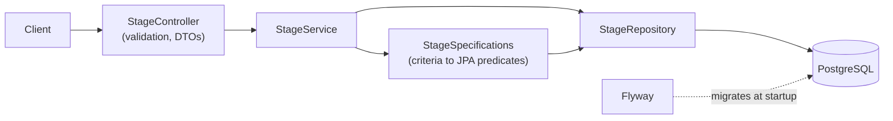
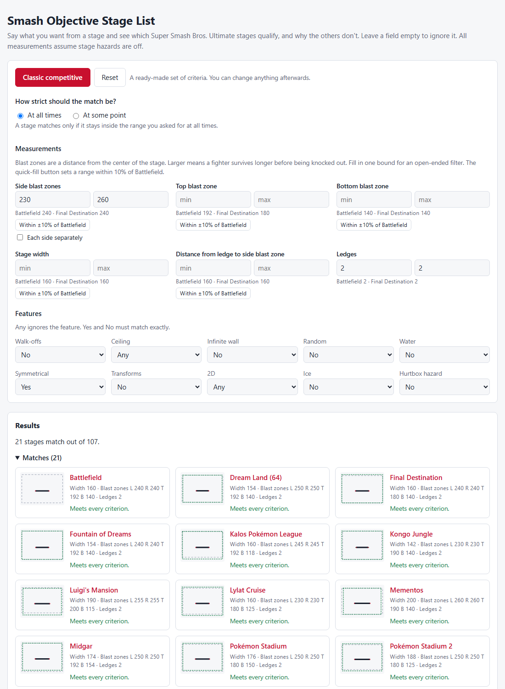

# Smash 5 Objective Stage List

[](https://github.com/Winktoblink/smash5-objective-stage-list/actions/workflows/ci.yml)


[](LICENSE)

A REST API that answers "which Super Smash Bros. Ultimate stages meet these requirements?" by filtering on measured stage properties instead of opinion.

**Try it: <https://winktoblink.github.io/smash5-objective-stage-list/>** (a static page that needs no server; published by [`pages.yml`](.github/workflows/pages.yml) once GitHub Pages is enabled for the repository).

## The problem

Competitive Smash communities regularly argue about which stages should be legal. The arguments are usually about feel: a stage is "too big", "too campy", "unfair". This service makes the criteria explicit. A caller states the measurable properties they care about, such as blast-zone distances, stage width, ledge count, or whether a stage has walk-offs or water, and gets back every stage that satisfies all of them. Two rulesets can then be compared by what they actually require.

## Example

Find stages with two ledges, symmetrical, and none of the usual banned hazards:

```bash
curl -X POST http://localhost:8080/api/v1/stages/search \
  -H 'Content-Type: application/json' \
  -d '{
        "ledgeCount": { "min": 2, "max": 2 },
        "features": {
          "walkOffs": false, "wallInfinite": false, "random": false, "water": false,
          "symmetry": true, "transform": false, "ice": false, "hurtBox": false
        }
      }'
```

The response has a `count` and the matching `stages`, sorted by name (28 stages here; trimmed to the first one):

```json
{
  "count": 28,
  "stages": [
    {
      "id": 5,
      "name": "Battlefield",
      "blastZones": {
        "left":   { "min": -240.0, "max": -240.0 },
        "right":  { "min": 240.0,  "max": 240.0 },
        "top":    { "min": 192.0,  "max": 192.0 },
        "bottom": { "min": -140.0, "max": -140.0 }
      },
      "stageWidth": 160.0,
      "distanceToBlastZone": { "min": 160.0, "max": 160.0 },
      "ledgeCount": { "min": 2, "max": 2 },
      "features": { "walkOffs": false, "ceiling": false, "...": "..." }
    }
  ]
}
```

The `count` of 28 and the stage shape come from a real run of this request against the Compose stack in CI.

## Tech stack

- Java 25, Spring Boot 4.1 (Web MVC, Data JPA, Validation, Actuator)
- PostgreSQL 18, schema and data managed by Flyway
- springdoc-openapi (Swagger UI)
- Spock, Testcontainers, JaCoCo
- Gradle 9 (Kotlin DSL, version catalog), Spotless
- Docker (multi-stage image) and Docker Compose, GitHub Actions

## Architecture



The code is organized by feature rather than by layer. Everything about stages lives under `stage`: `api` holds the controller and DTOs, `domain` holds the entity, repository and query logic, and the service sits between them. The API never exposes entities, and the domain has no web types. `common` holds the validation constraint and the error handler that are not specific to stages.

## Quick start

**Full stack in containers** (needs Docker):

```bash
docker compose --profile app up --build
```

Then open <http://localhost:8080/> for the search page, or <http://localhost:8080/swagger-ui.html> for the API docs. CI runs this exact command and checks the search above.

**Development** (needs JDK 25 and Docker). Spring Boot's Docker Compose support starts Postgres for you:

```bash
./gradlew bootRun
```

**Tests and checks** (needs JDK 25 and Docker, for Testcontainers):

```bash
./gradlew build
```

`bootRun` is not part of CI, but it was run locally: Postgres started automatically and the app served the API and the search page.

## API

| Method | Path | Response |
|---|---|---|
| `GET` | `/api/v1/stages` | `200`, all stages sorted by name |
| `GET` | `/api/v1/stages/{id}` | `200` with a stage, or `404` problem detail |
| `POST` | `/api/v1/stages/search` | `200` with `{ count, stages }`, or `400` problem detail |

How search filters behave:

- Every field is optional. `{}` returns all 107 stages.
- Range filters (`blastZones.left|right|top|bottom`, `distanceToBlastZone`, `ledgeCount`) use **containment** by default: a stage matches only if its whole `[min, max]` range lies inside the filter. Either bound can be omitted.
- Add `"rangeMatch": "OVERLAPS"` to match stages whose range only has to *touch* the filter, which finds stages that can reach it at some point. Omitting the field, or sending `"CONTAINED"`, gives the default. Any other value is a `400`. See [ADR-0004](docs/adr/0004-opt-in-overlap-matching.md).
- `stageWidth` is a single value and matches when it is inside the filter in both modes.
- Feature flags must match exactly when given; omit one to ignore it.
- A range with `min > max` is rejected with a `400`.

A search page at `/` (plain HTML and JavaScript modules, no build step) is built for tournament organizers. You enter blast zones as a distance from the center, pick "at all times" or "at some point", and every stage lands in **Matches**, **Near misses** (fails exactly one criterion) or **Excluded**, with each failed criterion explained in plain words. Each stage has a schematic diagram with Battlefield outlined for comparison, and there is a glossary. The page loads [`data/stages.json`](src/main/resources/static/data/stages.json) and evaluates everything in the browser, so it needs no API. See [ADR-0005](docs/adr/0005-ui-evaluates-criteria-in-the-browser.md).



The same page has a **stage list builder**: add stages from the results as starters or counterpicks, set the winner bans, DSR and Gentleman's Rule, and see errors and warnings (an even number of starters, a stage in both lists, too few stages left after bans, a chosen stage that fails your criteria). It suggests the game 1 striking order (1-1, 1-2-1 or 1-2-2-1) and can compare your criteria with a regional stage list. Everything you set is kept in the page's address, so **Copy link** shares your criteria, lists and settings; **Copy ruleset** produces Markdown for start.gg's rules tab; and **Download image** saves a 1200×675 PNG of the stage list (schematic diagrams, not game screenshots). The regional lists (Unified North American, Unified European, Midwest) were read from [SmashWiki](https://www.ssbwiki.com/Tournament_rulesets_(SSBU)) and are hidden until the project owner reviews them; add `?review=1` to the page's address to preview them.

Interactive API docs are at `/swagger-ui.html`, and ready-made requests are in [`http/stages.http`](http/stages.http).

## Design decisions

- **Containment for range filters.** A stage that only sometimes meets a requirement does not meet it. See [ADR-0001](docs/adr/0001-range-containment-filter-semantics.md). Overlap matching is available as an explicit opt-in: [ADR-0004](docs/adr/0004-opt-in-overlap-matching.md).
- **The page evaluates criteria in the browser.** It enables explanations, near misses and free static hosting; a golden-file test and shared conformance cases keep it in agreement with the API. See [ADR-0005](docs/adr/0005-ui-evaluates-criteria-in-the-browser.md).
- **Flyway owns the schema; Hibernate only validates.** A fresh database is always built the same way, and mapping drift fails at startup. See [ADR-0002](docs/adr/0002-flyway-owns-schema.md).
- **Tests run against real PostgreSQL, written in Spock.** See [ADR-0003](docs/adr/0003-testing-with-spock-and-testcontainers.md).
- **`POST` for search.** The filter is a nested document, which does not fit a query string cleanly.
- **No pagination.** The data set is a fixed list of about 107 game stages, so paging would add client complexity with no benefit.
- **RFC 9457 problem details** for every error, with a field-level `errors` list on validation failures.

## Testing strategy

- **Unit specs** (no Spring): range validation and DTO mapping.
- **Web slice** (`@WebMvcTest`): response shapes and the error contract, with the service mocked.
- **Integration** (`@SpringBootTest` + Testcontainers): the real app on `postgres:18-alpine`, with Flyway seeding all 107 stages. It checks known results such as the 28 stages above and the containment edge cases.
- **Snapshot and conformance** (Testcontainers): `StageDataSnapshotSpec` checks that the page's `data/stages.json` equals the API, and `StageConformanceSpec` runs the shared cases in `src/test/resources/search-conformance.json` against the API.
- **JavaScript** (Node's built-in runner, no dependencies): `node --test "src/test/js/*.test.mjs"` tests the page's logic and runs the same conformance cases through the JavaScript evaluator.
- JaCoCo fails the build below 80% line coverage.

## Data

The 107 stages and their measurements are in the Flyway migrations under [`src/main/resources/db/migration`](src/main/resources/db/migration). The measurements were compiled manually by the author. Every value assumes stage hazards are off. What each field means, the known gaps and how to report a correction are in [docs/DATA.md](docs/DATA.md).

To add or correct a stage, add a new migration (for example `V4__add_stage.sql`). Do not edit migrations that have already been applied. Then regenerate the page's copy of the data with `./gradlew test --tests '*StageDataSnapshotSpec' -PupdateStageSnapshot`; the build fails until `static/data/stages.json` matches the API.

## Roadmap

- Stage images and a richer UI (sorting, saved rulesets)
- Cache the stage list, which only changes with a deploy
- Publish the container image to GitHub Container Registry
- A hosted demo

## License

[MIT](LICENSE)
