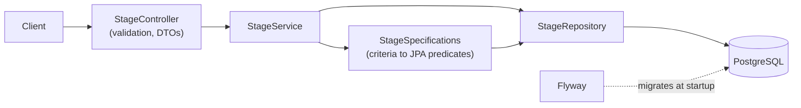

# Smash 5 Objective Stage List

[](https://github.com/Winktoblink/smash5-objective-stage-list/actions/workflows/ci.yml)


[](LICENSE)

A REST API that answers "which Super Smash Bros. Ultimate stages meet these requirements?" by filtering on measured stage properties instead of opinion.

## The problem

Competitive Smash communities regularly argue about which stages should be legal. The arguments are usually about feel: a stage is "too big", "too campy", "unfair". This service makes the criteria explicit. A caller states the measurable properties they care about, such as blast-zone distances, stage width, ledge count, or whether a stage has walk-offs or water, and gets back every stage that satisfies all of them. Two rulesets can then be compared by what they actually require.

## Example

Find stages with two ledges, symmetrical, and none of the usual banned hazards:

```bash
curl -X POST http://localhost:8080/api/v1/stages/search \
  -H 'Content-Type: application/json' \
  -d '{
        "ledgeCount": { "min": 2, "max": 2 },
        "features": {
          "walkOffs": false, "wallInfinite": false, "random": false, "water": false,
          "symmetry": true, "transform": false, "ice": false, "hurtBox": false
        }
      }'
```

The response has a `count` and the matching `stages`, sorted by name (30 stages here; trimmed to the first one):

```json
{
  "count": 30,
  "stages": [
    {
      "id": 6,
      "name": "BattleField (Common)",
      "blastZones": {
        "left":   { "min": -240.0, "max": -240.0 },
        "right":  { "min": 240.0,  "max": 240.0 },
        "top":    { "min": 192.0,  "max": 192.0 },
        "bottom": { "min": -140.0, "max": -140.0 }
      },
      "stageWidth": 160.0,
      "distanceToBlastZone": { "min": 160.0, "max": 160.0 },
      "ledgeCount": { "min": 2, "max": 2 },
      "features": { "walkOffs": false, "ceiling": false, "...": "..." }
    }
  ]
}
```

The `count` of 30 and the stage shape come from a real run of this request against the Compose stack in CI.

## Tech stack

- Java 25, Spring Boot 4.1 (Web MVC, Data JPA, Validation, Actuator)
- PostgreSQL 18, schema and data managed by Flyway
- springdoc-openapi (Swagger UI)
- Spock, Testcontainers, JaCoCo
- Gradle 9 (Kotlin DSL, version catalog), Spotless
- Docker (multi-stage image) and Docker Compose, GitHub Actions

## Architecture



The code is organized by feature rather than by layer. Everything about stages lives under `stage`: `api` holds the controller and DTOs, `domain` holds the entity, repository and query logic, and the service sits between them. The API never exposes entities, and the domain has no web types. `common` holds the validation constraint and the error handler that are not specific to stages.

## Quick start

**Full stack in containers** (needs Docker):

```bash
docker compose --profile app up --build
```

Then open <http://localhost:8080/> for the search page, or <http://localhost:8080/swagger-ui.html> for the API docs. CI runs this exact command and checks the search above.

**Development** (needs JDK 25 and Docker). Spring Boot's Docker Compose support starts Postgres for you:

```bash
./gradlew bootRun
```

**Tests and checks** (needs JDK 25 and Docker, for Testcontainers):

```bash
./gradlew build
```

`bootRun` is not part of CI, but it was run locally: Postgres started automatically and the app served the API and the search page.

## API

| Method | Path | Response |
|---|---|---|
| `GET` | `/api/v1/stages` | `200`, all stages sorted by name |
| `GET` | `/api/v1/stages/{id}` | `200` with a stage, or `404` problem detail |
| `POST` | `/api/v1/stages/search` | `200` with `{ count, stages }`, or `400` problem detail |

How search filters behave:

- Every field is optional. `{}` returns all 109 stages.
- Range filters (`blastZones.left|right|top|bottom`, `distanceToBlastZone`, `ledgeCount`) use **containment** by default: a stage matches only if its whole `[min, max]` range lies inside the filter. Either bound can be omitted.
- Add `"rangeMatch": "OVERLAPS"` to match stages whose range only has to *touch* the filter, which finds stages that can reach it at some point. Omitting the field, or sending `"CONTAINED"`, gives the default. Any other value is a `400`. See [ADR-0004](docs/adr/0004-opt-in-overlap-matching.md).
- `stageWidth` is a single value and matches when it is inside the filter in both modes.
- Feature flags must match exactly when given; omit one to ignore it.
- A range with `min > max` is rejected with a `400`.

A small search page at `/` (plain HTML and JavaScript, no build step) lets you set the filters and see the matching stages. Interactive API docs are at `/swagger-ui.html`, and ready-made requests are in [`http/stages.http`](http/stages.http).

## Design decisions

- **Containment for range filters.** A stage that only sometimes meets a requirement does not meet it. See [ADR-0001](docs/adr/0001-range-containment-filter-semantics.md). Overlap matching is available as an explicit opt-in: [ADR-0004](docs/adr/0004-opt-in-overlap-matching.md).
- **Flyway owns the schema; Hibernate only validates.** A fresh database is always built the same way, and mapping drift fails at startup. See [ADR-0002](docs/adr/0002-flyway-owns-schema.md).
- **Tests run against real PostgreSQL, written in Spock.** See [ADR-0003](docs/adr/0003-testing-with-spock-and-testcontainers.md).
- **`POST` for search.** The filter is a nested document, which does not fit a query string cleanly.
- **No pagination.** The data set is a fixed list of about 109 game stages, so paging would add client complexity with no benefit.
- **RFC 9457 problem details** for every error, with a field-level `errors` list on validation failures.

## Testing strategy

- **Unit specs** (no Spring): range validation and DTO mapping.
- **Web slice** (`@WebMvcTest`): response shapes and the error contract, with the service mocked.
- **Integration** (`@SpringBootTest` + Testcontainers): the real app on `postgres:18-alpine`, with Flyway seeding all 109 stages. It checks known results such as the 30 stages above and the containment edge cases.
- JaCoCo fails the build below 80% line coverage.

## Data

The 109 stages and their measurements are in the Flyway migrations under [`src/main/resources/db/migration`](src/main/resources/db/migration). The measurements were compiled manually by the author.

To add or correct a stage, add a new migration (for example `V3__add_stage.sql`). Do not edit migrations that have already been applied.

## Roadmap

- Stage images and a richer UI (sorting, saved rulesets)
- Cache the stage list, which only changes with a deploy
- Publish the container image to GitHub Container Registry
- A hosted demo

## License

[MIT](LICENSE)
